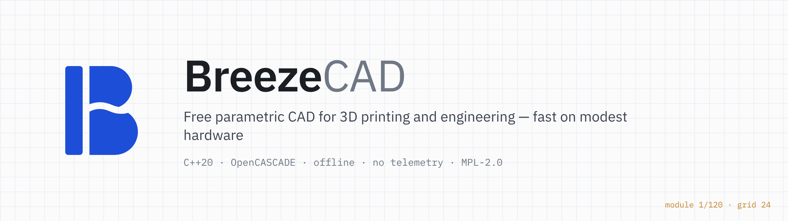
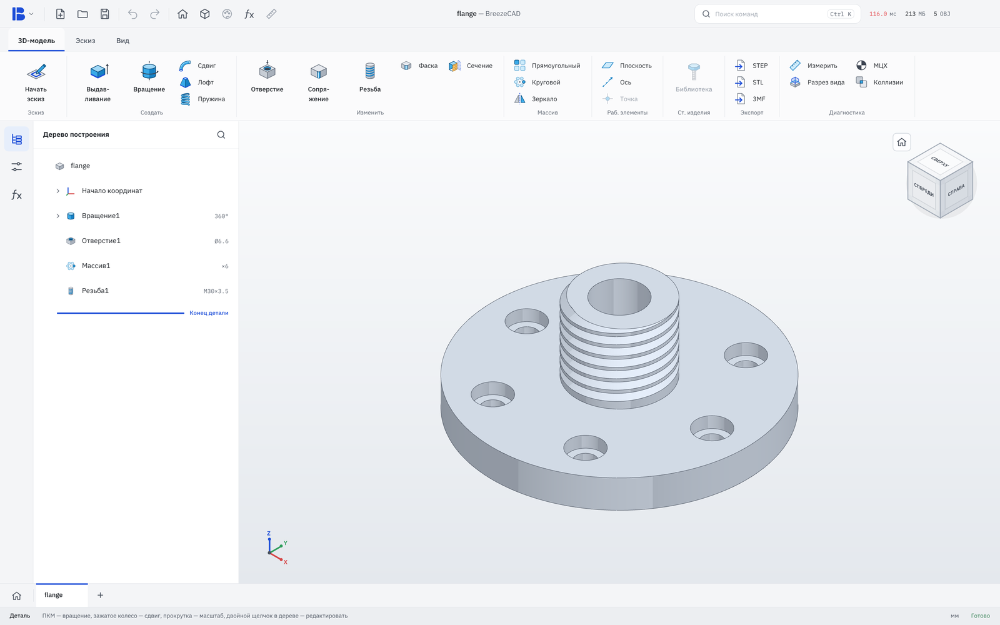
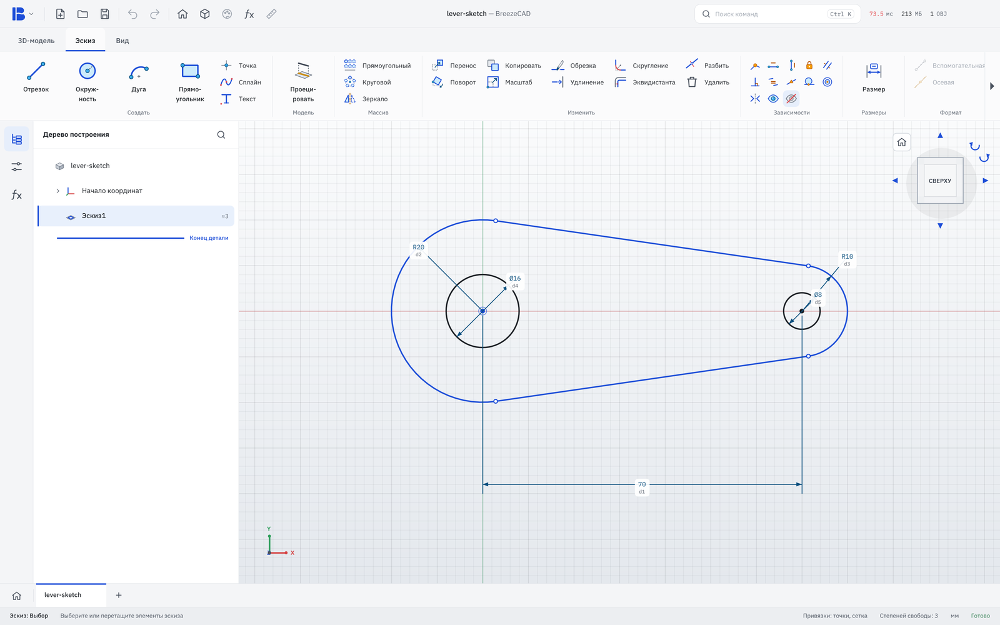
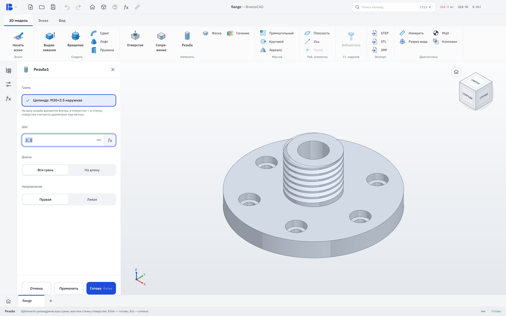
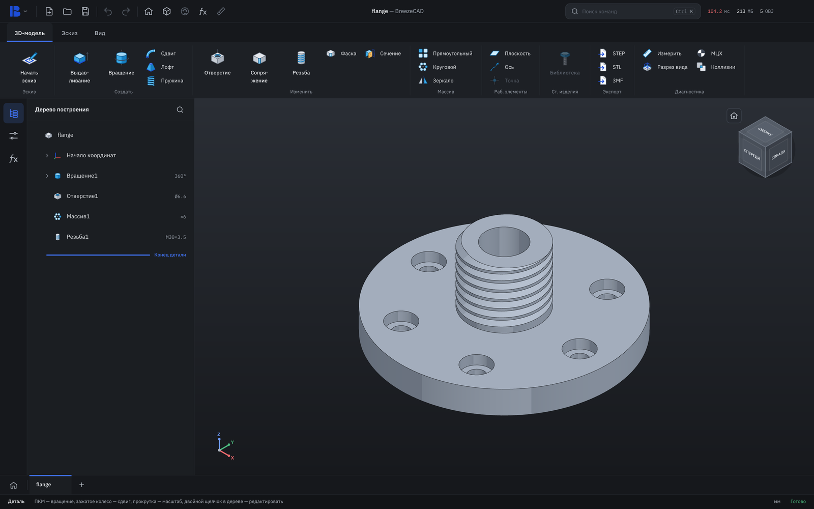

<p align="center"></p>

<p align="center">
  <b>Download:</b>
  <a href="https://github.com/MikeVerx/breezecad/releases/download/next-build/BreezeCAD-windows.zip"><b>Windows</b></a> ·
  <a href="https://github.com/MikeVerx/breezecad/releases/download/next-build/BreezeCAD-macos.zip"><b>macOS</b></a> ·
  <a href="https://github.com/MikeVerx/breezecad/releases/download/next-build/BreezeCAD-linux.tar.gz"><b>Linux</b></a> ·
  <a href="https://github.com/MikeVerx/breezecad/releases/tag/modules"><b>Modules</b></a> ·
  <a href="#build-from-source">Build from source</a> ·
  <a href="docs/ARCHITECTURE.md">Architecture</a> ·
  <a href="README.ru.md">Русский</a>
</p>

<p align="center">
  
  
  
</p>

**BreezeCAD** is a free, offline parametric CAD for parts you print, mill or
order. Sketch, constrain, extrude, drill and thread — in a familiar
Inventor-like ribbon that starts in a second and runs on a 4 GB laptop with
integrated graphics.

<p align="center"></p>

## Why

- **Offline, always.** No account, no cloud, no telemetry. Your files stay yours.
- **Light.** One small download; opens instantly on modest hardware.
- **Familiar.** Ribbon, feature tree and dialogs work the way Inventor and
  КОМПАС-3D users expect; mouse and shortcut presets for both.
- **Open.** MPL-2.0. Read the code, change it, ship your own modules.

## What it does today

| Sketch | Model |
| --- | --- |
| Lines, arcs, circles, ellipses, splines, rectangles, slots, polygons, text | Extrude and revolve (join, cut, intersect), drag handles |
| Constraints and dimensions with a live solver, degrees of freedom | Holes: simple, counterbore, countersink |
| Trim, extend, split, fillet, offset, move, rotate, scale, mirror, patterns | Fillet, chamfer, loft, sweep, coil |
| Project body edges into the sketch | **Modelled ISO metric threads** on shafts and in holes |
| | Work planes and axes, rectangular / circular patterns, mirror |
| | Section view, measure, mass properties, **interference check** |
| | Export STEP, STL, 3MF · own `.bzc` file format |

<table>
<tr>
<td width="50%"><br><sub>Sketch with tangencies and driving dimensions</sub></td>
<td width="50%"><br><sub>Thread: click a shaft or a hole, the size is detected (M30×3.5)</sub></td>
</tr>
<tr>
<td width="50%"><br><sub>Light and dark themes, interface scale for any screen</sub></td>
<td width="50%" valign="top">

**Status.** Early preview: the part modeller is usable, assemblies and
drawings are not there yet. Expect rough edges — and please
[report them](https://github.com/MikeVerx/breezecad/issues).

**Languages.** The interface is Russian today; translations are plain JSON
catalogs — see [`translations/`](translations/README.md).

</td>
</tr>
</table>

## Download

The freshest build of the `next` branch, rebuilt after every change that
passes the tests on all three systems ([all files](https://github.com/MikeVerx/breezecad/releases/tag/next-build)).
Unpack and run — nothing to install.

| System | Download | Status |
| --- | --- | --- |
| Windows 10/11, 64-bit | [BreezeCAD-windows.zip](https://github.com/MikeVerx/breezecad/releases/download/next-build/BreezeCAD-windows.zip) | main platform, in beta test |
| macOS 14+ on Apple silicon (M1 and newer) | [BreezeCAD-macos.zip](https://github.com/MikeVerx/breezecad/releases/download/next-build/BreezeCAD-macos.zip) | new: built and tested in CI, first runs on real Macs now |
| Linux x86_64 (Ubuntu 20.04+, Debian 10+, Fedora and other distributions from 2019 on) | [BreezeCAD-linux.tar.gz](https://github.com/MikeVerx/breezecad/releases/download/next-build/BreezeCAD-linux.tar.gz) | built, tested and started in CI |

**macOS, first start:** the app is not signed by a paid Apple certificate
yet, so macOS stops it once. Right-click `BreezeCAD.app` → **Open** → **Open**;
on macOS 15 and newer: double-click, then **System Settings → Privacy &
Security → Open Anyway**.

Beta testers take the `BreezeCAD-beta-*` builds of the same release: they
keep logs for bug reports (written only on your computer) and come with
instructions in Russian.

Touchpads work on all three systems: two fingers pan (Shift: orbit), pinch
zooms; on a Mac also turning two fingers, smart zoom and force click.
Everything is in **Settings → Тачпад**.

### Tested hardware

The weakest computer a tester has run BreezeCAD on stably:

| | |
| --- | --- |
| Device | 14″ laptop, HD or Full HD screen |
| Processor | 6th-generation Intel Core i5 (i5-6200U / i5-6300U, 2 cores, 4 threads) |
| Graphics | integrated Intel HD Graphics 520 |
| Memory | 8 GB DDR4 |
| Storage | SSD |

No discrete graphics card needed. If BreezeCAD runs for you on something
weaker, tell us and it goes in the table.

The latest numbered release with its notes is on the [Releases](https://github.com/MikeVerx/breezecad/releases/latest) page.

### Modules

Modules add features and are downloaded separately — only the ones you
need. Every module, what it does and its file for each system are on the
**[BreezeCAD modules](https://github.com/MikeVerx/breezecad/releases/tag/modules)** page. Install one in **Settings → Модули →
«Установить модуль…»** or drop the `.bzmod` file onto the program's window.

| Module | What it does |
| --- | --- |
| [MCP server for Claude](modules/mcp/README.md) | Claude builds in the open BreezeCAD: sketches, features, assemblies, a picture of the model — 65 tools |

## Build from source

Requires a C++20 compiler, CMake ≥ 3.24, Ninja, OpenCASCADE (7.6+ or 8), GLFW 3
and OpenGL 3.3.

```sh
# Debian / Ubuntu
sudo apt install build-essential cmake ninja-build libocct-*-dev libglfw3-dev libgl1-mesa-dev libxi-dev
cmake --preset linux-debug
cmake --build --preset linux-debug
ctest --preset linux-debug          # tests
./build/linux-debug/bin/breezecad
```

```sh
# macOS (Apple silicon), Homebrew
brew install cmake ninja glfw opencascade
cmake --preset macos -DCMAKE_PREFIX_PATH="$(brew --prefix)"
cmake --build --preset macos
ctest --preset macos
./build/macos/bin/breezecad
```

Windows builds use MSYS2 / MinGW64; the packages for all three systems
(`scripts/package-*.sh`) — the exact steps are in
[`.github/workflows/build.yml`](.github/workflows/build.yml).

## Contributing

Start with [`docs/ARCHITECTURE.md`](docs/ARCHITECTURE.md) — modules, data flow
and step-by-step recipes for adding a sketch tool, a model operation or a
setting. Then [`CONTRIBUTING.md`](CONTRIBUTING.md) for the rules and the commit
format. Bugs and ideas: [issues](https://github.com/MikeVerx/breezecad/issues).

## License

[Mozilla Public License 2.0](LICENSE). Changes to BreezeCAD files come back to
the project; your own modules built on top can stay closed.

Created by **MikeVerx**. Geometry by [Open CASCADE Technology](https://dev.opencascade.org),
interface by [Dear ImGui](https://github.com/ocornut/imgui).

<sub>Autodesk Inventor is a trademark of Autodesk, Inc.; КОМПАС-3D is a trademark of ASCON. They are mentioned only to describe familiar workflows; BreezeCAD is an independent project, not affiliated with or endorsed by them, and uses none of their code, icons or files.</sub>
